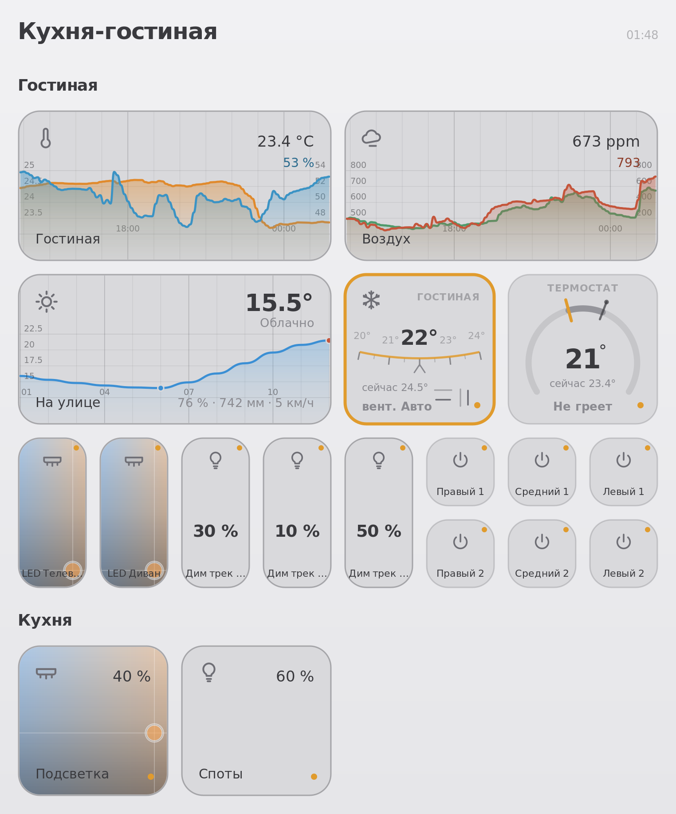

# wb-svg-panel

Панели умного дома для контроллеров [Wiren Board](https://wirenboard.com):
демон на Python отдаёт комнаты как SVG-картинки по HTTP. Открывается в любом
браузере, на планшете на стене, на телефоне, в киоск-режиме — везде, где есть
адрес контроллера.

<!-- Замените на свой скриншот: положите файл в docs/screenshot.png -->


Один процесс делает всё:

* держит постоянную подписку на `/devices/+/controls/+` и хранит состояние в памяти;
* тянет историю для графиков из `wb-mqtt-db` — напрямую из SQLite или через MQTT-RPC;
* рендерит панель через Jinja2 и отдаёт как `image/svg+xml`.

Вся внешность живёт в одном шаблоне `templates/panel.svg.j2`. Python туда не
лезет — он считает числа и геометрию. Хотите другой вид плитки — правите
шаблон, жмёте F5, рестарт не нужен.

## Чем это отличается от штатного веб-интерфейса

Веб-интерфейс Wiren Board — инструмент наладчика: списки устройств и каналов.
Эта панель — то, что показывают домашним: комнаты, крупные плитки, графики за
последние 12 часов, прогноз погоды. Она не заменяет вебморду, а живёт рядом,
по адресу `/panel/`.

## Что нужно

* контроллер Wiren Board (проверено на WB7, Debian 11 и Debian 12, Python 3.9+);
* `wb-mqtt-db` для графиков — он есть в прошивке из коробки;
* около 40 МБ на `/mnt/data`.

Всё, что рисует панель, берётся из MQTT. Устройства сторонних интеграций
(Sprut.hub, Zigbee2MQTT) работают, если они публикуются в тот же брокер:
достаточно указать полный топик вместо пары «устройство/канал».

## Установка

Код должен лежать на `/mnt/data` — это единственный раздел, который переживает
обновление прошивки.

```sh
ssh root@wirenboard-xxxxxxxx.local
apt update && apt install -y git
mkdir -p /mnt/data && cd /mnt/data
git clone https://github.com/USER/wb-svg-panel.git
cd wb-svg-panel
cp config.example.yaml config.yaml   # правим под свои устройства
sh install.sh
```

`install.sh` ставит зависимости, systemd-юнит и конфиг nginx. Он идемпотентен:
его же запускают после обновления прошивки, чтобы вернуть всё на место.

Панель открывается по `http://wirenboard-xxxxxxxx.local/panel/`.

### Обновление

```sh
cd /mnt/data/wb-svg-panel
git pull
systemctl restart wb-svg-panel
```

Рестарт нужен только после правок `panel.py`. Конфиг перечитывается сам по
времени изменения файла, шаблон — тоже (`auto_reload`), так что правки
внешности и раскладки видны сразу по F5. Если менялись `*.service`,
`nginx-*.conf` или список зависимостей — вместо рестарта `sh install.sh`.

## Адреса

| Адрес | Что отдаёт |
|---|---|
| `/panel/` | список панелей с живыми превью |
| `/panel/<имя>.svg` | панель картинкой |
| `/panel/<имя>.html` | обёртка с автообновлением и нажатиями — для планшета |
| `/panel/channels` | все каналы контроллера, чтобы искать имена для конфига |
| `/panel/docs` | подробный справочник по типам плиток |
| `/panel/healthz` | состояние демона |
| `/panel/stats` | счётчики нагрузки (смотреть через `tools/watch-load.py`) |
| `/panel/api/screen/<имя>` | раскладка для esp32-panel: `cols`, обычные `w`/`h` и секции-заставки `screensaver: 30s` (с 1.76); пульт света, набор сцен и типы `tv`, `leak`, `weather`, `today` (с 1.77, esp32-panel 0.10+), `clock` (с 1.77.3; отрисовка и режимы `view` — esp32-panel 0.11.8+); `swipe: true` у панели разрешает листание вкладок (с 1.77.2, esp32-panel 0.11.7+) |
| `/panel/api/screen/<имя>/theme` | палитра темы экрана по ролям: `mode`, `revision` (ETag, 304), `palette` (с 1.78, esp32-panel 0.12+; [docs/SCREEN_THEME.md](docs/SCREEN_THEME.md)) |
| `/panel/api/screen/<имя>/chart/<n>` | история графика для esp32-panel 0.7+ |
| `/panel/api/screen/<имя>/screensaver/chart/<n>` | история графика заставки (с 1.76) |
| `/panel/api/screen/<имя>/today/<n>` | дела и события плитки `today`/`agenda` (с 1.77) |
| `/panel/api/screen/<имя>/screensaver/today/<n>` | то же для заставки (с 1.77) |
| `/panel/cam/<имя>.mjpeg?width=480&fps=5` | уменьшенный MJPEG для экрана ESP32-S3 (с 1.75) |
| `/panel/fw/firmware.json` | `latest` и список опубликованных прошивок esp32-panel (с 1.77.5) |
| `/panel/fw/esp32-panel-X.Y.Z.bin` | неизменяемый файл прошивки конкретной версии (с 1.77.5) |

Страница `.html` — это PWA: на телефоне её можно добавить на домашний экран,
и она откроется без адресной строки, как приложение.

## Публикация прошивок esp32-panel

Хранение прошивок появилось в 1.77.5; для публикации и OTA используйте 1.77.7+.
В 1.77.6 исправлено чтение полей `esp_app_desc_t`, а в 1.77.7 — скачивание
`.bin` на контроллерах со старой Flask. Файлы хранятся внутри установки панели:
`/mnt/data/wb-svg-panel/data/firmware/`. Каталог создаётся штатным `install.sh`;
отдельное правило nginx не нужно, потому что `/panel/` уже проксируется в демон.
Бинарные файлы и `firmware.json` не попадают в Git.

Соберите прошивку кнопкой гаечного ключа в VS Code, затем отдельной командой
`python tools/release.py` подготовьте версионный файл в репозитории
esp32-panel. Скопируйте полученный `.bin` в корень панели на контроллере,
затем выполните один скрипт:

```sh
cd /mnt/data/wb-svg-panel
python3 tools/firmware_publish.py esp32-panel-0.11.12.bin
curl http://192.168.1.77/panel/fw/firmware.json
```

Скрипт не собирает проект и не запускает OTA. Он читает имя проекта и версию
из самого образа ESP-IDF, вычисляет размер и SHA-256, сохраняет файл как
`data/firmware/esp32-panel-X.Y.Z.bin` и атомарно обновляет `firmware.json`.
Повторно публиковать тот же файл можно; заменить уже выпущенную версию другим
содержимым нельзя — нужно поднять версию.

Чтобы добавить старую версию в список, но не делать её последней:

```sh
python3 tools/firmware_publish.py esp32-panel-0.11.9.bin --no-latest
```

esp32-panel 0.11.10+ проверяет `latest` через минуту после старта, затем раз
в час и по кнопке. Автоматически устанавливается только версия новее текущей;
имя файла и версия внутри скачанного образа должны совпадать с манифестом.
Более ранняя версия по-прежнему загружается вручную `.bin`-файлом через
веб-страницу экрана. Пока на сервере остаётся более новый `latest`, следующая
автоматическая проверка снова обновит экран. Отдельного `version.json` нет.

## Конфиг

Всё описывается в `config.yaml` — какие панели, какие плитки, какие каналы.
Пример со всеми типами плиток: [`config.example.yaml`](config.example.yaml).

```yaml
panels:
  livingroom:
    title: "Гостиная"
    cols: 4
    tiles:
      - type: light
        title: "Лента у окна"
        channel_switch: "wb-led_42/CCT1"
        channel_brightness: "wb-led_42/CCT1 Brightness"
```

Типы плиток: `chart` · `forecast` · `clock` · `thermostat` · `ac` · `light` · `dimmer` ·
`curtain` · `roller` · `switch` · `value` · `link`.

Размеры задаются в половинках плитки: `0.5` — мелкая (78 px), `1` — обычная
(170 px), `2` — двойная (354 px). У `clock` с `view: clock_weather` плитка делится на два поля: `1×1` — часы
и погода по полю 1×0.5 (одно над другим, разделитель строго посередине),
`2×1` — по полю 1×1 рядом, `2×0.5` — по полю 1×0.5 рядом, узкая `1×0.5` —
пополам: время и «значок + температура». `view: clock` и `view: weather`
(с 1.79.1) заполняют всю плитку: кегль считается от её размера, в `2×0.5`
время и дата стоят в одну строку, широкая погода — слева значок с
температурой, справа описание и показатели. Видимое название не выводится;
`title` остаётся у раскрытого прогноза. Влажность, давление и ветер выводятся
значениями без подписей. Описание `description` (например, «Пасмурно») и
`extra` (`89 % · 751 мм · 11 км/ч`) получают меньший кегль по своей ширине;
совсем длинная строка дополнительно сжимается ровно по доступному месту. Отрицательная температура тоже подгоняется
по ширине. Текст и значок поддерживают все темы и тёмные карточки `color: dark`. Панели можно собирать из других панелей через
`sections: [{from: kitchen}]` — плитки не дублируются, комнатная панель
помечается `hidden: true` и служит источником.

Имена каналов проще не набирать руками, а взять со страницы `/panel/channels`.
Если у вас настроены комнаты в веб-интерфейсе, черновик конфига сделает
`wb-rooms-to-config.py`.

## Шторы

Плитка `curtain` показывает положение створок и управляет приводом.
Короткое нажатие открывает или закрывает, долгое — открывает пульт: та же
плитка крупно, правая створка тянется от центра к краю.

```yaml
- type: curtain
  title: "Штора"
  channel: "wb-mcm8_15/Position"          # текущее положение, 0-100
  channel_state: "wb-mcm8_15/State"       # необязательно: едет или стоит
  command_topic: "…"                      # куда писать, если канал сырой
  command_topic_stop: "…"                 # необязательно: остановка на ходу
  command_stop: "2"
  command_open: "100"                     # по умолчанию 100
  command_close: "0"                      # по умолчанию 0
```

Кнопка «Стоп» на пульте появляется, только если задан `command_topic_stop`:
такая характеристика есть не у всех приводов, а рисовать неработающую кнопку
хуже, чем не рисовать вовсе.

Для каналов Wiren Board `command_topic` не нужен — адрес команды выводится из
имени канала. Для сырых топиков моста он обязателен, см.
[docs/DEVICES.md](docs/DEVICES.md).

Панель публикует команды только в топики, перечисленные в конфиге у
нарисованных плиток. Список конечный и собирается при каждом обращении, так
что новый топик в конфиге начинает работать сразу, а посторонний не пройдёт
даже при подмене запроса.

## Управление и доступ

По умолчанию панель только показывает. `interactive: true` включает нажатия:
свет, диммеры, шторы, выключатели. Демон при этом публикует команды **только**
в топики тех каналов, которые нарисованы на панели, — список конечный и берётся
из конфига.

Отсюда — про доступ. Панель, которая умеет включать свет, не должна быть
открыта всей сети. `install.sh` кладёт `nginx-panel-location.conf` в точку
расширения `/etc/nginx/includes/default.wb.d/`, где действует правило
`satisfy any`: пускает по адресу из списка подсетей **либо** по паролю.
Свою подсеть посмотрите через `ip -4 addr show` и поправьте список.

Запасной вход на порту 8080 (короткий адрес без `/panel/` — удобно для планшета
или ESP32) по умолчанию выключен. Включается явно:

```sh
sh install.sh --with-8080
sh close-8080.sh     # проверить, что и кому он открыт, и при желании закрыть
```

Наружу в интернет контроллер выставлять не надо — для удалённого доступа есть
Wiren Board Cloud или VPN.

## Если что-то не так

```sh
python3 diag.py             # файлы, зависимости, MQTT, база истории, конфиг
sh check-history.sh         # почему пустые графики
sh check-nginx.sh           # почему /panel/ отдаёт вебморду вместо панели
python3 why-no-chart.py     # разбор одного конкретного графика
journalctl -u wb-svg-panel -f
```

Самая частая причина пустых графиков — канал не пишется в `wb-mqtt-db` или
общий лимит группы `+/+` делится на сотни каналов. `check-history.sh` покажет
готовую группу для `/etc/wb-mqtt-db.conf`.

## Разработка

Ноутбук — единственное место, где меняется код; контроллеры только тянут.
Файл `config.yaml` в `.gitignore`: у каждого дома он свой, `git pull` его не
трогает.

Перед коммитом полезно прогнать `sh check-secrets.sh` — он ищет попавшие в
файлы имена контроллеров, облачные адреса, идентификаторы Sprut.hub и пароли.

CI проверяет совместимость с Python 3.9 (в прошивках на Debian 11 он ещё 3.9,
и синтаксис новее туда не поедет), синтаксис YAML и шелл-скрипты.

### Стенд графика для esp32-panel

Без контроллера, MQTT и SQLite:

```sh
python3 tools/esp32-chart-demo.py --out /tmp/esp32-chart
python3 tools/esp32-chart-demo.py --serve --port 8080  # настоящий HTTP API
python3 tests/screen_chart_check.py                    # проверка графиков
python3 tests/screen_saver_check.py                    # проверка заставки
python3 tests/firmware_check.py                        # публикация и раздача OTA
```

Первый вариант пишет `layout.json`, `history.json` и `values.txt`; скрипт печатает
команды симулятора для снимков плитки и полноэкранного графика. В демо — три
кривые по 90 точек. История отдаётся отдельно от раскладки, поэтому новые точки
не вызывают перезапуск ESP32.

Issues и pull requests приветствуются. Особенно интересны новые типы плиток —
они добавляются макросом в `templates/panel.svg.j2` и небольшой функцией
подготовки данных в `panel.py`.

## Лицензия

MIT — см. [LICENSE](LICENSE).

Проект не связан с компанией Wiren Board и не поддерживается ею.


### Управляемая конфигурация плиток

С 1.80.0 демон читает исходный YAML и управляемый формат `schema: 2`.
Для перехода запустите команды от пользователя, которому доступны
рабочие файлы панели. Укажите путь к основному конфигу:

```sh
python3 -m wbpanel.editor_cli --config config.yaml migrate
python3 -m wbpanel.editor_cli --config config.yaml migrate --apply
python3 -m wbpanel.editor_cli --config config.yaml history
python3 -m wbpanel.editor_cli --config config.yaml rollback legacy-0
```

Первая команда проверяет кандидат и печатает сводку изменений без
значений. `--apply` публикует проверенную миграцию. Исходник с комментариями
остаётся в локальной ревизии `legacy-0` под `data/editor/`. Команда
`history` также восстанавливает файлы при незавершённой публикации.
Используйте относительные `!include` внутри каталога основного конфига
для операций с ревизиями. Подробности в
[архитектуре редактора](docs/PANEL_EDITOR_ARCHITECTURE.md).


### Структурный редактор панелей

Откройте **Редактор панелей** с главной страницы панели (`/panel/editor`
при штатной настройке nginx). Для исходного YAML сначала выполните явную
миграцию по инструкции выше.

1. Выберите панель и раздел. Для импортированной секции откройте ссылку
   на панель-источник.
2. Найдите элемент в библиотеке и добавьте экземпляр. В списке выберите
   плитку, измените её порядок, размеры с шагом 0,5 или название.
   На телефоне свойства открываются справа, кнопка × возвращает к списку.
   Пустое поле возвращает значение из библиотеки. Сохранение сохраняет
   положение страницы; стрелки рядом со строкой меняют порядок плиток.
3. Нажмите «Обновить предпросмотр», чтобы увидеть изменения в SVG.
   После сохранения прежний SVG остаётся на месте; автоматического
   обновления каждые 12 секунд нет. Пульт открывается отдельно.
   Тема и колонки над изображением действуют только в просмотре.
   Для сохранения колонок, темы, видимости и заставки в YAML нажмите
   «Настройки панели». «Настройки раздела» задают его название
   и интервал заставки ESP32 (первый положительный интервал определяет
   и задержку запуска, и смену разделов).
4. Нажмите «Проверить и показать изменения», затем подтвердите публикацию.
   История показывает опубликованные ревизии и позволяет восстановить
   предыдущую управляемую ревизию с отдельным подтверждением.

У выключателя есть отдельная форма привязки: `channel` и необязательный
`command_topic`. Если плитка ссылается на `element`, эта форма меняет все
размещения элемента, а размеры и название выше остаются локальными. Для
inline-плитки schema 3 привязка тоже локальная. Перед сохранением показаны
затронутые панели; проверка и подтверждение публикации повторяют этот список.
Привязки через `service/roles` пока меняются в YAML. Защищённые значения
не показываются: оставьте такое поле без изменений, чтобы сохранить ссылку.

Откройте «Панели, разделы и экраны ESP32» под выбором раздела.
Кнопка «Скопировать панель» запросит новый ID и название, «Скопировать секцию» —
название копии, которая появится сразу после исходной секции. Копии имеют
отдельные ID плиток и независимые размеры; ссылки на общую библиотеку остаются
общими. Копирование не переназначает ESP32 и применяется только при публикации.
Структурные include в копии становятся самостоятельной раскладкой; перенос
локального `!secret` между каталогами пока отклоняется.
Новую панель задают ID и названием. Для нового раздела достаточно названия.
При первом добавлении раздела к панели без `sections` её корневые плитки переходят
в него в исходном порядке, включая ссылку `!include`. Удаление раздела убирает
его размещения с панели. Чтобы назначить экран, выберите панель, укажите сетевое
имя из настроек ESP32 (например, `panel-6a10`) и нажмите «Назначить выбранную панель».
После публикации следующий запрос экрана к `/api/screen/<имя>` получит новую раскладку.
Список имён показывает явные назначения в конфигурации.

Черновик хранится в памяти демона. При внешней правке конфига или
публикации из второго черновика откройте новый черновик и повторите
нужные изменения. Исходный снимок `legacy-0` можно восстановить через CLI или кнопкой «Вернуть конфигурацию до миграции» в истории редактора. После подтверждения редактор покажет команды повторной миграции.
Чтобы демон мог публиковать изменения, его служба должна иметь запись
в каталог конфига, включая каталоги затронутых `!include`. Штатный
systemd unit 1.81.0 предоставляет этот доступ и монтирует код и ресурсы
демона в режиме чтения. При собственном reverse proxy передавайте
внешний Host с портом и корректный `X-Forwarded-Proto`.

Проверки без контроллера и MQTT:

```sh
python3 tests/editor_check.py
python3 tests/routes_check.py
python3 tests/render_check.py
python3 tests/screen_tiles_check.py
python3 tests/screen_theme_check.py
node tests/js_check.js
node tests/browser_check.js
```

`routes_check.py` включает проверки API, включённых YAML, изоляции
предпросмотра, секретов, конфликтов и восстановления после ошибки записи.
Браузерная проверка использует Playwright и Chromium.


### Библиотека после миграции

Из исходного конфига выполните проверку и затем примените результат:

```sh
python3 -m wbpanel.editor_cli migrate
python3 -m wbpanel.editor_cli migrate --apply
```

В `elements.yaml` ключом служит ID, например `switch-001`. Определение
содержит все заданные в исходной плитке поля, включая размеры и название.
Для плиток из вложенных каталогов библиотека подключает определения через
`!include`, сохраняя область действия локальных секретов. В панели остаётся
упорядоченный список экземпляров, например `{element: switch-001, w: 2, h: 1}`.
Повторное добавление того же элемента создаёт новый ID экземпляра. Исходные
пользовательские ID сохраняются. Ранее опубликованные схемы 2 и 3 редактор
открывает напрямую.
